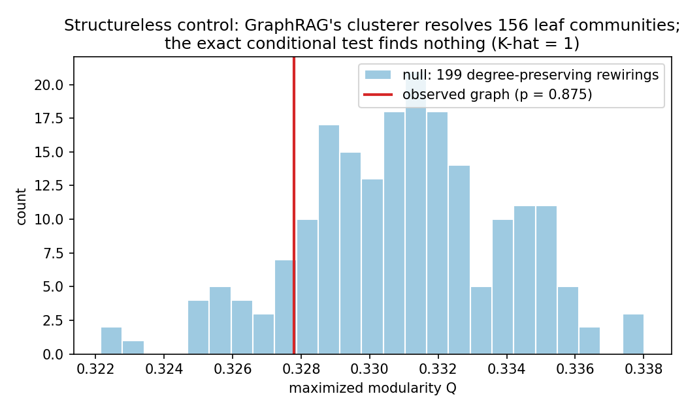
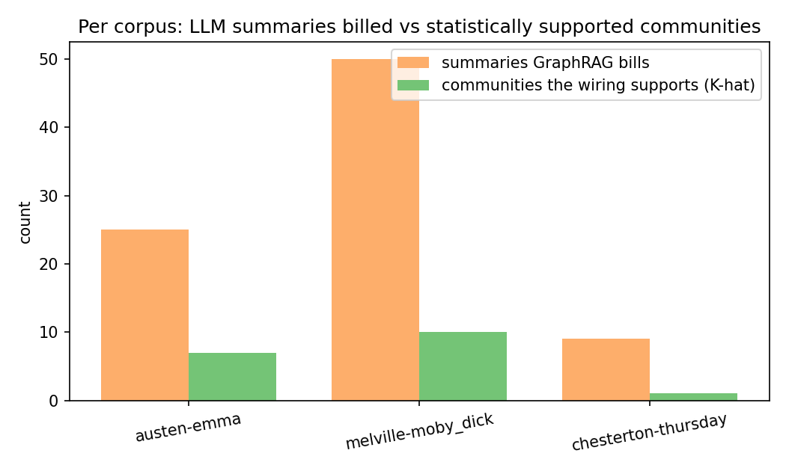

# graphrag-phantom-communities

**An exact statistical audit of the communities Microsoft GraphRAG pays an LLM to summarize.**

GraphRAG bills one LLM "community report" per community in its entity graph.
This project asks a question the pipeline never asks: *are those communities
real, or are they artifacts of the clustering algorithm?* It answers with an
exact, degree-preserving hypothesis test wrapped around GraphRAG's own
clusterer.

**TL;DR**

- On a graph with **no structure at all**, GraphRAG's clusterer resolves
  **156 leaf communities** (194 summaries billed). The exact test returns
  **p = 0.875, K-hat = 1**. Every one of those summaries would describe noise.
- On graphs with 5 planted communities, the test **recovers K = 5 exactly**
  at every noise level tested, so it has power, not just a high bar.
- On three real corpora, **79% of the summaries GraphRAG would bill** are
  for communities the wiring does not support; where structure is real the
  partition is still **2.6–3.7× finer** than the data justifies.

> **About this repository.** This is a from-scratch reconstruction of a team
> project I did earlier; the original code was never committed. Every number
> in this README was produced by the code here (see [Reproduce](#reproduce)),
> and `results/*.json` are the raw outputs of those runs. Nothing is copied
> from the earlier project or from the literature.

---

## Why this matters

GraphRAG's indexing pipeline extracts entities and relationships from
documents into a graph, runs **hierarchical Leiden** to carve the graph into
nested communities, and then has an LLM write a report for every community
at every level. The report is the unit of cost: more communities, bigger bill.

Leiden, like every modularity-maximizing clusterer, **always returns
communities**. It will happily partition a random graph into dozens of
tidy groups, because that is what maximizing modularity does. Nothing in
GraphRAG checks whether the partition is supported by the data before paying
to summarize it.

So the audit question is: given the graph GraphRAG actually built, how many
communities does the wiring statistically support, and how does that compare
to the number GraphRAG bills?

## Method

**The clusterer under audit** is `graspologic.partition.hierarchical_leiden`
with `max_cluster_size=10`, the same function and default that GraphRAG's
`cluster_graph` operation calls. We wrap it directly rather than reimplement
it, so the communities we test are the communities GraphRAG would summarize.
We count leaf communities and total communities across all levels; the latter
is the number of summaries billed in full indexing mode.

**The null model** is the set of all simple graphs with *exactly* the observed
degree sequence. We sample from it by double edge swaps (5 × m swaps per
sample), which never change any node's degree. Conditioning on degrees is the
whole point: a handful of hub entities can produce high modularity on their
own, and this null removes degree heterogeneity as an explanation. A
rejection means group structure beyond what the degrees already imply.

**The test statistic** is maximized modularity Q, found by Louvain with a
seeded restart. The Monte Carlo p-value is
p = (1 + #{Q_null ≥ Q_obs}) / (1 + B) with B = 199 null samples. This is a
valid finite-sample p-value, which is what "exact" means here: no asymptotic
approximation, no parametric assumption about the graph.

**K-hat** estimates how many communities are supported. Test the whole graph.
If it rejects, split it into the top-level partition and recurse into each
part with at least 40 nodes, to a maximum depth of 2. Every decision is
Bonferroni-corrected by the realized number of tests. K-hat is the number of
leaves where splitting stopped; a graph that never rejects gets K-hat = 1.

**Fineness ratio** is Leiden leaf communities divided by K-hat: how much
finer the partition GraphRAG summarizes is than the structure the data
supports.

A detail that matters: with B = 99 null samples the smallest attainable
p-value is 0.01, and Bonferroni across six tests makes that 0.06, so a true
split could *never* survive correction. B = 199 gives a floor of 0.005, which
is why that is the committed setting.

## Results

### 1. Structureless control

A Chung–Lu graph with a heavy-tailed degree distribution, mimicking real
entity graphs (a few hub entities, many rare ones), and **zero** planted
community structure. 771 nodes, 2,677 edges, largest connected component.

| | |
|---|---|
| GraphRAG's clusterer | **156 leaf communities**, 194 total across 3 levels (16 → 100 → 78) |
| Exact conditional test | Q_obs = 0.328 vs. null mean 0.331, **p = 0.875** |
| K-hat | **1** (Bonferroni p = 0.875, one test) |



The observed graph sits in the middle of its own null distribution. GraphRAG
would nonetheless bill 194 community reports for it.

### 2. Power check: planted partition

Graphs with K = 5 planted communities, 500 nodes, mean degree 10, at three
mixing levels (mu is the expected fraction of a node's edges that leave its
community).

| mu | p | K-hat | Bonferroni root p | Leiden leaves | Leiden total |
|---|---|---|---|---|---|
| 0.10 | 0.005 | **5** | 0.03 | 99 | 132 |
| 0.25 | 0.005 | **5** | 0.03 | 107 | 142 |
| 0.40 | 0.005 | **5** | 0.03 | 109 | 143 |

The test detects the structure and recovers the exact number of communities
every time. Leiden's leaf partition is roughly 20× finer than the truth.

### 3. Three real corpora

Public-domain novels, fetched via NLTK's Gutenberg corpus. Pipeline: raw
text → regex entity co-occurrence graph → GraphRAG's clusterer on the
weighted graph it would build → audit on the unweighted backbone, where the
swap null is exact.

| corpus | nodes / edges | p | K-hat | Leiden leaves | billed | excess | fineness |
|---|---|---|---|---|---|---|---|
| *Emma* | 110 / 351 | 0.005 | 7 | 18 | 25 | 18 | 2.6× |
| *Moby Dick* | 180 / 360 | 0.005 | 10 | 37 | 50 | 40 | 3.7× |
| *The Man Who Was Thursday* | 48 / 90 | 0.135 | 1 | 7 | 9 | 8 | 7.0× |



Where structure is real (*Emma*, *Moby Dick*), the Leiden partition is still
2.6–3.7× finer than the wiring supports. On the smallest graph the test does
not reject at all, yet 9 summaries would be billed. Across the three corpora,
66 of 84 billed summaries (79%) describe communities the data does not
support.

### 4. Cost model

`src/cost.py` converts community counts into summaries billed, summaries
supported, and an indicative dollar figure. Tokens per report (4,000 in,
500 out) and prices are parameters; the committed JSON uses a reference price
for illustration only. The price-independent number is the summary count.

## Not in the committed results

**LLM extractor comparison.** `src/extract_llm.py` compares a local LLM
extractor (any OpenAI-compatible endpoint; Ollama by default) against the
regex baseline on node and edge recall, on the same text chunks. It was not
run for the committed results because this build ran in a CPU-only sandbox
with no model server. To run it:

```bash
ollama pull llama3.2:3b
python src/extract_llm.py --book austen-emma --chunks 50
```

## Reproduce

```bash
python3 -m venv .venv && source .venv/bin/activate
pip install -r requirements.txt
python experiments/run_all.py        # ~10–15 min on a laptop CPU
```

Or run the pieces: `run_control.py`, `run_planted.py`, `run_corpora.py`,
then `make_figures.py`. Seeds are fixed, Leiden and Louvain are seeded, and
node insertion order is deterministic, so a rerun reproduces the committed
JSON given the same library versions.

## Limitations

- The test statistic uses Louvain rather than Leiden for the modularity
  search. Both maximize modularity; the choice affects power, not validity.
- K-hat is a conservative pruning estimate, not a consistent estimator of
  the number of blocks under a particular generative model. Parts with fewer
  than 40 nodes are not tested further, so on small graphs K-hat equals the
  top-level partition size whenever the root rejects.
- The regex extractor (capitalized phrases, sentence co-occurrence) is a
  transparent, reproducible baseline, not a good extractor.
- The corpora are character networks from novels, not the enterprise
  document sets GraphRAG targets. The structureless control is the cleanest
  result; the corpus results show the direction of the effect, not its
  magnitude on arbitrary data.

## Background reading

- *A generalized hypothesis test for community structure in networks*
  (arXiv:2107.06093): framing "are the communities real?" as a formal test.
- *Testing for Global Network Structure Using Small Subgraph Statistics*
  (arXiv:1710.00862): testing against the configuration model without
  choosing clusters first.
- *Adjusted chi-square test for degree-corrected block models*
  (arXiv:2012.15047): sequential degree-conditioned testing to estimate the
  number of communities.

## Layout

```
src/
  leiden_wrap.py     GraphRAG's clusterer (hierarchical_leiden) and community counts
  null_models.py     degree-preserving swaps; structureless and planted generators
  test.py            exact conditional test; hierarchical Bonferroni K-hat
  extract_regex.py   regex entity co-occurrence graphs
  extract_llm.py     LLM extractor and recall vs. regex (run locally)
  cost.py            summaries billed vs. supported
experiments/
  run_control.py  run_planted.py  run_corpora.py  make_figures.py  run_all.py
results/
  *.json             raw outputs of the committed runs
  fig_*.png          figures
```

MIT licensed.
